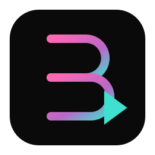
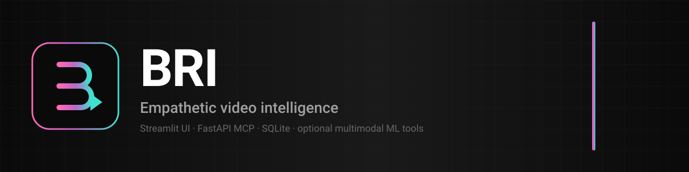
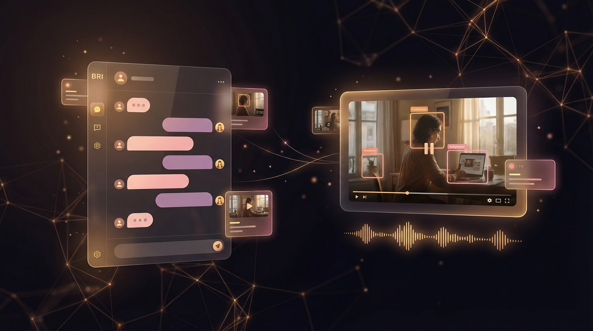
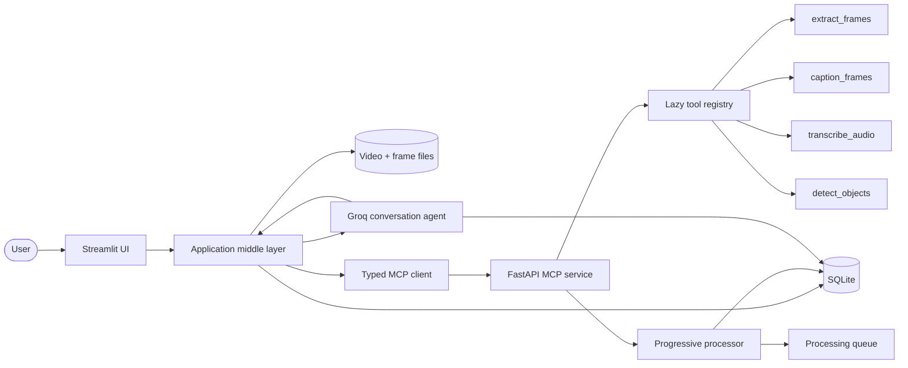

<div align="center">
  
  

# BRI: Conversational video intelligence that feels human

## Empathetic multimodal video analysis: upload, watch, ask, remember

[](https://github.com/Alexi5000/Bri/actions/workflows/ci.yml)
[](LICENSE)
[](https://python.org)
[](https://fastapi.tiangolo.com)
[](https://streamlit.io)
[](https://sqlite.org)
[](https://docker.com)

</div>




BRI (Brianna) is an open-source multimodal video intelligence agent. It extracts frames, captions scenes, transcribes
speech, and detects objects through a FastAPI MCP service and a Streamlit interface, then answers natural-language
questions about the media using a Groq-backed conversational agent with per-video memory. It is designed for teams that
want to ship a real product on top of open weights rather than wire a notebook to a vector store every time.

## Why this exists

**What it does.** BRI extracts frames, captions scenes, transcribes speech, and detects objects for an uploaded video
through a FastAPI tool service, stores the results in SQLite, and answers natural-language questions about the video
from a Streamlit chat panel using a Groq-backed agent with per-video memory. Captioning, transcription, and detection
run on open models (BLIP, Whisper, YOLOv8) that load lazily only when a tool executes.

**Who it serves.** Small teams and solo operators who want a self-hosted video question-and-answer tool where the media
and derived data stay on their own disk, and developers who want a working reference for a Streamlit front end, a typed
middle layer, and a schema-first tool API in one Python codebase.

**Why Alex built it.** Alex Cinovoj, Founder & CTO of TechTide AI, started BRI on 2025-10-14 (repository created the
same day; first commit `6d3e3d4`, "Initial project setup: directory structure, dependencies, and configuration"). The
original product steering file committed with that first commit stated the goal: make "video analysis feel like
discussing content with a knowledgeable friend", be "accessible for users of all technical levels", and stay
"privacy-focused with local storage by default", built on open-source tools (OpenCV, Whisper, BLIP, YOLO) plus Groq's
LLM (`.kiro/steering/product.md` and `.kiro/specs/bri-video-agent/requirements.md` at `6d3e3d4`). The repository was
then reworked into an "open-source flagship" with CI, typed errors, and contract tests (`FINAL_REPORT.md`, 2026-07-09).

**Real-world use case (2025-2026 evidence).** A small team runs BRI on one machine to ask questions about recorded
sessions ("what is the speaker holding at 0:15?") without sending the footage to a hosted video service. The upload,
processing, and chat path is exercised end to end by `tests/integration/test_e2e_video_processing.py` and the contract
suites under `tests/production/`, which run in CI on Linux and Windows (324 tests passed, 30 skipped on 2026-10-21).
**Verified in this repository** at the test-suite level; the Groq client is mocked in those tests, so live model
answers still require a `GROQ_API_KEY`. The tool service follows the schema-first discovery pattern that the Model
Context Protocol specification standardizes (`GET /tools` lists tools with JSON schemas, `POST /tools/{name}/execute`
runs one); it does not implement the MCP wire protocol itself.[^1] The UI targets the Streamlit 1.4x releases shipped
during 2025.[^2] Conversational answers use Groq's OpenAI-compatible chat API, whose model and SDK changes are tracked
in the Groq changelog.[^3]

## Hero

```text
                ┌──────────────────────────────────────────────────┐
                │                   Streamlit UI                    │
                │  welcome · library · player · chat · history      │
                └────────────────────────┬─────────────────────────┘
                                         │
                ┌────────────────────────▼─────────────────────────┐
                │              Application middle layer             │
                │   upload · delete · chat · progress · health     │
                └──────────┬───────────────────────────┬───────────┘
                           │                           │
                  ┌────────▼─────────┐         ┌───────▼────────┐
                  │  SQLite + files  │         │   MCP client   │
                  └──────────────────┘         └───────┬────────┘
                                                      │
                          ┌───────────────────────────▼───────────┐
                          │            FastAPI MCP service         │
                          │  /health  /tools  /videos/{id}/...     │
                          └───────────────────────────┬───────────┘
                                                      │
                  ┌──────────┬────────────┬────────────┼───────────┬──────────┐
                  ▼          ▼            ▼            ▼           ▼          ▼
              extract_    caption_    transcribe_   detect_    progressive  circuit
              frames      frames      audio         objects    processor    breaker
```

## 30-second quickstart

```bash
git clone https://github.com/Alexi5000/Bri.git
cd Bri
cp .env.example .env          # add GROQ_API_KEY for live conversational responses
docker compose up --build
```

Open the Streamlit application at `http://localhost:8501` and the FastAPI service at `http://localhost:8000`. Upload a
video on the welcome screen and ask the chat panel a question about it.

## 5-minute tutorial

```bash
# 1. Install the package and dev extras into a fresh virtualenv.
python -m venv .venv && source .venv/bin/activate
pip install -e .[dev]

# 2. Initialize the local SQLite database and runtime directories.
python scripts/init_db.py

# 3. Start the MCP server (terminal A).
uvicorn mcp_server.main:app --reload --port 8000

# 4. Start the Streamlit UI (terminal B).
streamlit run app.py
```

Upload a short clip on the welcome screen. BRI extracts representative frames, captions each, transcribes audio, and
detects objects. Then ask the chat panel a question such as "what is the speaker holding at 0:15?" and watch the tool
chain run end to end.

If you want to opt into the full local multimodal pipeline (BLIP captioning, Whisper transcription, YOLOv8 detection),
install the `ai` extra:

```bash
pip install -e .[ai,dev]
```

## Architecture



The middle layer is the single source of truth for upload, delete, chat, health, progress, and persistence readiness.
The UI never speaks SQL or HTTP directly; the API never speaks Streamlit. Tool discovery is wired in lean CI, while
BLIP, Whisper, YOLOv8, and sentence-transformers are loaded lazily only when a tool actually executes.

## API surface

| Endpoint                                      | Kind | Description                                                           |
| --------------------------------------------- | ---- | --------------------------------------------------------------------- |
| `GET /health`                                 | HTTP | Liveness probe, dependency status, version, and operational metadata. |
| `GET /tools`                                  | HTTP | Lists registered MCP-style video tools and their JSON schemas.        |
| `GET /v1/tools`                               | HTTP | Versioned variant of `/tools`.                                        |
| `POST /tools/{tool_name}/execute`             | HTTP | Executes a validated video tool request.                              |
| `POST /videos/{video_id}/process`             | HTTP | Runs the standard processing plan for one stored video.               |
| `POST /videos/{video_id}/process-progressive` | HTTP | Starts staged processing with progress tracking.                      |
| `GET /videos/{video_id}/status`               | HTTP | Reads stored processing state and context availability.               |
| `bri-video-agent`                             | CLI  | Console entry point installed by `pip install bri-video-agent`.       |

## Configuration

| Variable                 | Default       | Effect                                                      |
| ------------------------ | ------------- | ----------------------------------------------------------- |
| `APP_ENV`                | `development` | Selects runtime mode (`development`, `test`, `production`). |
| `GROQ_API_KEY`           | _unset_       | Enables live conversational AI responses.                   |
| `DATABASE_PATH`          | `data/bri.db` | SQLite database location.                                   |
| `VIDEO_STORAGE_PATH`     | `data/videos` | Where uploaded videos are stored.                           |
| `FRAME_STORAGE_PATH`     | `data/frames` | Where extracted frame images are stored. Explicit `frame_paths` passed to `caption_frames` / `detect_objects` must resolve inside `FRAME_STORAGE_PATH/<video_id>`. |
| `MCP_SERVER_HOST`        | `localhost`   | MCP service host.                                           |
| `MCP_SERVER_PORT`        | `8000`        | MCP service port.                                           |
| `REDIS_ENABLED`          | `false`       | Enables optional Redis-backed caching when configured.      |
| `MAX_FRAMES_PER_VIDEO`   | `20`          | Caps frame extraction per video (lower for speed).          |
| `TOOL_EXECUTION_TIMEOUT` | `60`          | Per-tool timeout in seconds.                                |

See [`.env.example`](.env.example) for the full list. The defaults are test-friendly; set `APP_ENV=production` and
provide `GROQ_API_KEY` for live responses.

## Documentation

| Guide                   | Link                                                     |
| ----------------------- | -------------------------------------------------------- |
| Architecture            | [docs/ARCHITECTURE.md](docs/ARCHITECTURE.md)             |
| API reference           | [docs/API.md](docs/API.md)                               |
| Testing strategy        | [docs/TESTING.md](docs/TESTING.md)                       |
| Configuration reference | [docs/CONFIGURATION.md](docs/CONFIGURATION.md)           |
| Deployment guide        | [docs/DEPLOYMENT.md](docs/DEPLOYMENT.md)                 |
| Operations runbook      | [docs/OPERATIONS_RUNBOOK.md](docs/OPERATIONS_RUNBOOK.md) |
| Troubleshooting         | [docs/TROUBLESHOOTING.md](docs/TROUBLESHOOTING.md)       |

## Quality bar

BRI follows the **Uncle Bob** clean-code review documented in
[`docs/architecture/UNCLE_BOB_CLEAN_CODE_REVIEW.md`](docs/architecture/UNCLE_BOB_CLEAN_CODE_REVIEW.md). Every module in
`mcp_server/`, `services/`, `tools/`, `storage/`, `ui/`, `models/`, and `utils/` declares its responsibility in a
module-level docstring; every public function declares its contract in a one-line docstring; every exception subclasses
`services.errors.BriError`; every logger call uses lazy `%-format`; every public API surface is generated from
docstrings by `mkdocstrings` and deployed with the release. The data-flow and database-schema reasoning lives alongside
the code in the `docs/architecture/` directory.

## Security

### Administrative access

Set `BRI_ADMIN_TOKEN` to an independently generated secret of at least 32 characters on the server.
Administrative requests must include `Authorization: Bearer <secret>`. Missing or short configuration disables
administrative access (503); missing or incorrect credentials return 401 before any administrative effect.
Keep this token out of browser bundles and use TLS for network requests. Cache deletion and circuit-breaker
resets require this token. Existing ordinary application operations retain their current access behavior.

### Vulnerability reporting

Read [SECURITY.md](SECURITY.md) for supported versions, the private email channel for reporting a suspected
vulnerability, and operator guidance. Do not open a public issue for a security problem.

### Dependency and code-scanning status

As of 2026-10-21 the repository has 0 open secret-scanning alerts and 0 critical or high code-scanning alerts.
Dependabot opened 10 alerts against `requirements.lock.txt` on 2026-10-21 (certifi, and nine Pillow advisories fixed in
Pillow 13.0.0); the lock now pins certifi 2026.10.19, Pillow 13.0.0 and Streamlit 1.66.1, so each alert closes when
Dependabot re-reads the lock. CodeQL runs on push, pull request, and a weekly schedule (`.github/workflows/codeql.yml`)
and currently reports 142 open lower-severity findings in the Security tab: 60 medium `py/log-injection` warnings
(request-derived values reaching log calls) and 82 code-quality notes such as unused imports and empty `except`
blocks. None of these have been dismissed; they are tracked as open work. Dependabot version updates are intentionally disabled
(`.github/dependabot.yml`, `updates: []`); dependency upgrades are handled manually in grouped pull requests, and the
pinned lock lives in `requirements.lock.txt`.

## Contributing

See [CONTRIBUTING.md](CONTRIBUTING.md) for environment setup, branch naming, commit message format, and review SLA. Bug
reports and feature requests go through the issue templates under `.github/ISSUE_TEMPLATE/`.

## License

Released under the [MIT License](LICENSE).

[^1]: Model Context Protocol, "Specification (2025-06-18)", https://modelcontextprotocol.io/specification/2025-06-18, published 2025-06-18.
[^2]: Streamlit, "2025 release notes", https://docs.streamlit.io/develop/quick-reference/release-notes/2025, entries dated March 4, 2025 through October 29, 2025.
[^3]: Groq, "Changelog", https://console.groq.com/docs/changelog, entries dated May 2025 through 2026-04-18.
